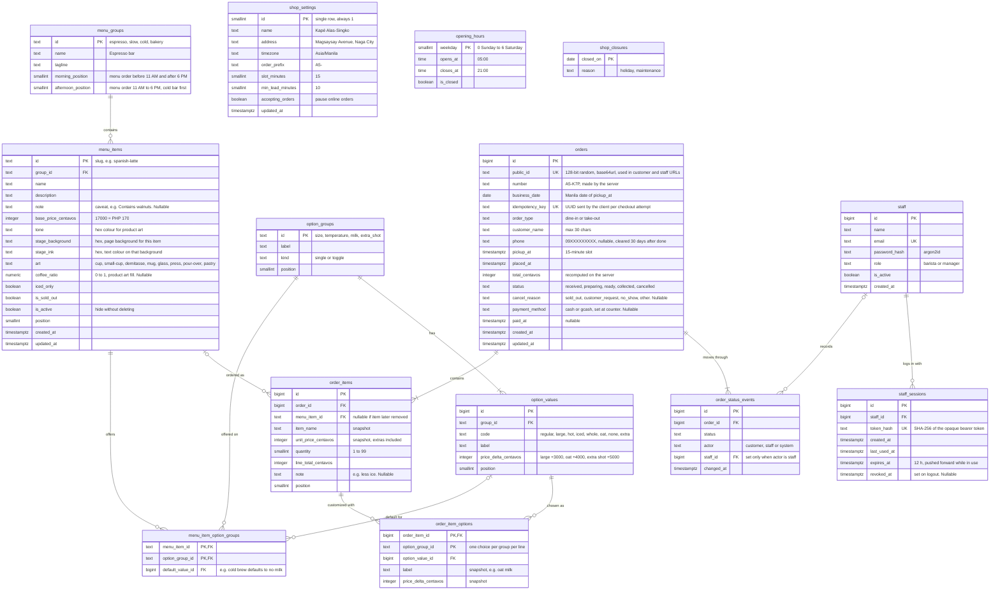

# Kapé Alas-Singko — Entity Relationship Diagram

Database for the backend (Postgres, managed with Drizzle). It is based on what the frontend shows and sends, and it replaces the data that used to live in `frontend/src/data/menu.ts`, `frontend/src/lib/pricing.ts`, `frontend/src/lib/time.ts` and `frontend/src/lib/shop.ts`. The API that sits on top of it is in [api.md](api.md).

## Constraints and indexes

- `orders`: `UNIQUE (number, business_date)`, `UNIQUE (public_id)`, `UNIQUE (idempotency_key)`. Index on `(business_date, status, pickup_at)` for the board and on `updated_at` for the `?since=` cursor.
- `order_item_options`: composite foreign key `(option_value_id, option_group_id)` to `option_values (id, group_id)`, so a line cannot have two milks or a value from the wrong group. Primary key `(order_item_id, option_group_id)`.
- `order_status_events`: `CHECK (actor <> 'staff' OR staff_id IS NOT NULL)`.
- `orders.status` and `cancel_reason` are `CHECK` constrained to their lists. `cancel_reason` is required when `status = 'cancelled'`.
- All money columns are integer centavos with `CHECK (>= 0)`. The API and the database use the same unit.

## Notes

- **Snapshots on orders.** `order_items` and `order_item_options` copy the name, label and price at the time of ordering, so a later menu or price change does not rewrite past orders. This replaces the `items JSONB` column in the old `backend/db/schema.sql`, which is dropped.
- **Customizations.** `menu_item_option_groups` replaces the `hasSizes`, `hasTemperatures`, `hasMilk` and `hasExtraShot` flags. An item with no rows (bakery) is not customizable. `iced_only` items skip the temperature group.
- **Presentation columns.** `stage_background`, `stage_ink` and `art` replace `STAGE_COLORS` and the item-id checks in `pickVessel`. The SVG drawings stay in the frontend and are picked by `art`. An iced drink still draws as a glass at runtime.
- **No customers table.** The site has no accounts. "My orders" stays in the browser (zustand `persist`): up to 5 orders, each kept until 2 hours after pickup. Orders keep their own name and phone.
- **Business date.** `business_date` is the Manila date of `pickup_at`, not `placed_at`. An order placed at 9:30 PM for 5 AM belongs to tomorrow's queue. Order numbers are unique within a business date, not forever.
- **Staff.** Replaces the single shared `STAFF_TOKEN`. `order_status_events` gives the tracker real timestamps for each step and records who moved the order. `barista` and `manager` have the same rights in v1.
- **Phone retention.** `orders.phone` is set to null 30 days after an order is collected or cancelled. The cleanup query runs when staff log in.
- **Seed.** The menu is seeded from the old `menu.ts` by an idempotent `npm run seed` (upsert), so rerunning it never duplicates rows.
